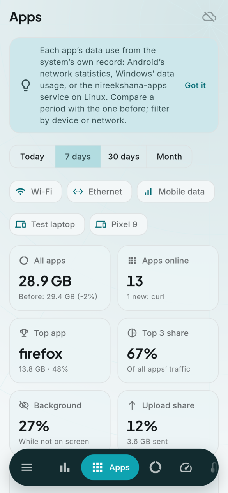
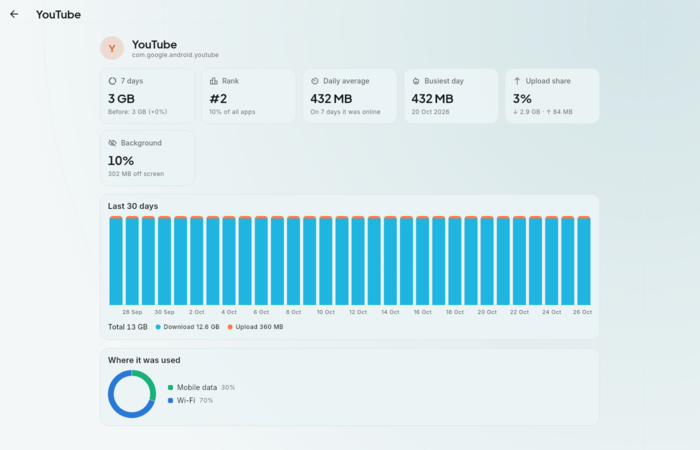
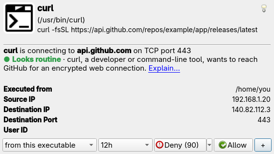
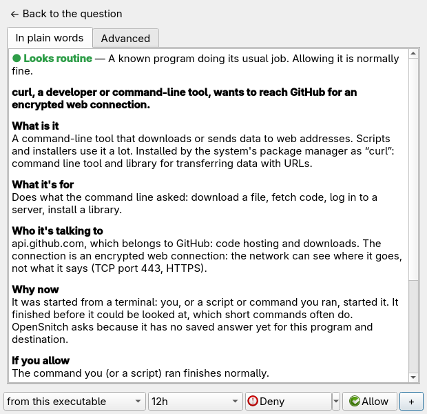
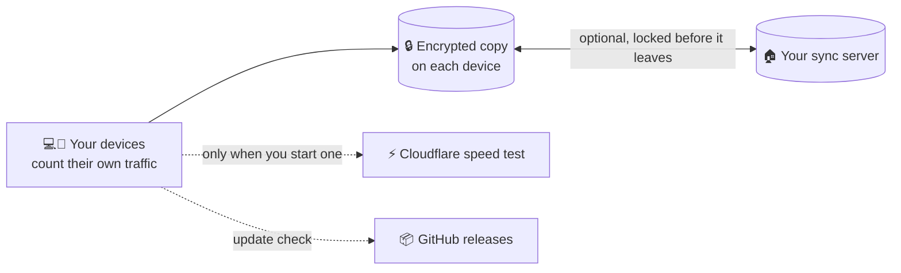

<h1 align="center">
  <br>
  <a href="https://github.com/sudharamachandranrajeev/bahya-nireekshana"></a>
  <br>
  Bahya Nireekshana
  <br>
</h1>

<h4 align="center">See how much internet data each device, app and website uses, and stay inside your data plan.</h4>

<p align="center">
  <a href="https://github.com/sudharamachandranrajeev/bahya-nireekshana/releases"></a>
  
  
  <a href="https://github.com/sudharamachandranrajeev/brahma"></a>
</p>

<p align="center">
  <a href="#-what-it-does">What it does</a> •
  <a href="#-get-started">Get started</a> •
  <a href="#-how-it-works">How it works</a> •
  <a href="#-faq-and-troubleshooting">FAQ</a> •
  <a href="#%EF%B8%8F-for-developers">For developers</a>
</p>

<p align="center">
  
</p>

*Bāhya nirīkṣaṇa* is Sanskrit for "watching what goes out". The app is for anyone on a capped
mobile or broadband plan, or who wants to know where their data goes. It counts on your own
devices, keeps the history, and warns you before a plan runs out. Status: **early (0.2)**. It
works day to day, but some pages are Linux-only (see below).

## ✨ What it does

- 📡 **Live speed** – download and upload on two gauges and a two-minute chart, plus today,
  yesterday and this month. It notes when today runs well above your usual day.
- 📊 **Usage history** – days, weeks or months as a chart, by kind of network (Wi-Fi, Ethernet,
  mobile data) or by device. See the month's likely total and the busiest day, and export to CSV.
- 📱 **Usage per app** – how much each app used today, this week or this month, against the period
  before. Tap an app for its last 30 days.
- 📦 **Data plans** – enter your allowance and renewal day. See what is left, where you will end up
  at this pace, and how much you can use each day. A warning comes at the level you pick.
- ⚡ **Speed test** – download, upload, delay and jitter (how much the delay wobbles), with a history
  of results by network and device.
- 🔌 **Connections** (Linux, Windows) – every program talking to the network right now, and to
  where.
- 🛡️ **Firewall** (Linux) – block or allow sites and addresses, and review what the firewall
  ([OpenSnitch](https://github.com/evilsocket/opensnitch)) has allowed or blocked.
- 💬 **Prompts in plain words** (Linux) – when the firewall asks about a connection, it also says
  what the program is, what it's for, why it's connecting now, and what allowing or denying will
  do, with the technical details one tab away.
- 🌐 **Browser extension** – data used by each website in Chrome, Edge and Firefox, with daily
  budgets and a blocklist.
- 🔒 **Private by design** – data is encrypted on the device. Sync between your devices is optional,
  and your own server only ever holds scrambled data.

...and more: eight themes and a theme editor, an Omarchy bar widget, and in-app updates.

<details>
<summary><b>Where each feature works</b></summary>

| Feature | Linux | Windows | Android | Browser extension |
| --- | --- | --- | --- | --- |
| Live speed, usage history, data plans, speed test | Yes | Yes | Yes | – |
| History from before the app was installed | Yes, with `vnstat` | No | Yes, with usage access | – |
| Usage per app | Yes, after the [Omarchy setup](omarchy/README.md) | Yes (Windows 10 and 11) | Yes, with usage access | Per website |
| Connections | Yes | Yes | No (Android hides them) | – |
| Firewall | Yes, after the [Omarchy setup](omarchy/README.md) | No | No | Blocklist |
| Prompts in plain words | Yes, after the [Omarchy setup](omarchy/README.md) | No | No | – |
| Sync with your other devices | Yes | Yes | Yes | No |
| In-app updates | Yes | Yes | Yes | No |

</details>

## 📸 Screenshots

<table>
  <tr>
    <td align="center"><br><sub>Now</sub></td>
    <td align="center"><br><sub>Usage</sub></td>
    <td align="center"><br><sub>Plans</sub></td>
  </tr>
  <tr>
    <td align="center"><br><sub>Apps</sub></td>
    <td align="center"><br><sub>Speed test</sub></td>
    <td align="center"><br><sub>Now (dark)</sub></td>
  </tr>
</table>

<p align="center">
  <br>
  <sub>Usage on a desktop window</sub>
</p>

<table>
  <tr>
    <td align="center"><br><sub>One app</sub></td>
    <td align="center"><br><sub>Connections</sub></td>
    <td align="center"><br><sub>Themes (Saffron)</sub></td>
  </tr>
</table>

<table>
  <tr>
    <td align="center"><br><sub>A firewall prompt, with the verdict</sub></td>
    <td align="center"><br><sub>Explain…: the whole story</sub></td>
  </tr>
</table>

<sub>All screenshots show made-up devices and usage, rendered from the current code.</sub>

## 🚀 Get started

### Step 1 – Download

Open the [releases page](https://github.com/sudharamachandranrajeev/bahya-nireekshana/releases) and,
under the newest release, pick the file for your device:

| Your device | File to download | Works on |
| --- | --- | --- |
| 🐧 Linux computer | `Nireekshana-<version>-linux-x64.tar.gz` | Ubuntu 22.04+, Fedora, Arch, Omarchy (64-bit x86) |
| 🪟 Windows computer | `Nireekshana-<version>-windows-x64-setup.exe` | Windows 10 and 11 |
| 🤖 Android phone | `Nireekshana-<version>-android.apk` | Android 7 and newer |
| 🌐 Chrome or Edge | `Nireekshana-<version>-chrome.zip` | Chrome 116 and newer, Edge |
| 🦊 Firefox | `Nireekshana-<version>-firefox.zip` | Firefox 140 and newer |

Each release also has `SHA256SUMS.txt`, a list of fingerprints to check the files are genuine.

### Step 2 – Install

<details>
<summary><b>🐧 Linux</b></summary>

1. Open a terminal in the folder where the download landed.
2. Unpack it and run the installer as your normal user (not `sudo`):
   ```sh
   tar -xzf Nireekshana-*-linux-x64.tar.gz
   cd nireekshana-*-linux-x64 && ./install.sh
   ```
3. Open **Bahya Nireekshana** from your app menu.

The app needs GTK 3, libsecret and a desktop keyring (the app that stores passwords) running and
unlocked. For history from before the app was installed, also install `vnstat`. To remove the app
later: `./install.sh --uninstall`. Your data stays.

</details>

<details>
<summary><b>🪟 Windows</b></summary>

1. Double-click `Nireekshana-<version>-windows-x64-setup.exe`. No admin rights needed.
2. Windows may say *"Windows protected your PC"*. This appears because the app isn't paid-signed
   yet, not because it is harmful. Click **More info → Run anyway**.
3. Follow the installer, then open **Bahya Nireekshana** from the Start menu.

Prefer no installer? Download `…-windows-x64-portable.zip`, unzip it anywhere and run
`nireekshana.exe`.

</details>

<details>
<summary><b>🤖 Android</b></summary>

1. Open the downloaded `.apk` on your phone.
2. If Android asks, allow installs from your browser or file manager. This is normal for apps
   from outside an app store.
3. Tap **Install**, then **Open**.

</details>

<details>
<summary><b>🌐 Chrome or Edge extension</b></summary>

1. Unzip `Nireekshana-<version>-chrome.zip` into a folder you will keep.
2. Open `chrome://extensions` (or `edge://extensions`) and turn on **Developer mode**.
3. Click **Load unpacked** and pick the folder.

</details>

<details>
<summary><b>🦊 Firefox extension</b></summary>

1. Open `about:debugging#/runtime/this-firefox`.
2. Click **Load Temporary Add-on** and pick `Nireekshana-<version>-firefox.zip`.
3. If the popup asks for access to all sites, click **Allow access**. Without it nothing can be
   measured.

The add-on isn't signed yet, so Firefox removes it when it restarts. Load it again after
each restart.

</details>

### Step 3 – First launch

There is no set-up screen. The **Now** page opens and starts counting at once.

1. **Android**: on **Now** or **Apps**, tap **Allow usage access**, then switch it on for Bahya
   Nireekshana. This brings in Android's own history and the usage per app.
2. **Add your data plan**: open **Plans → Add plan**. Enter the allowance, the renewal day and when
   to warn you, then **Save**.
3. **Test your speed**: open **Speed test** and tap **Start**.
4. **Look back**: open **Usage** and pick **Days**, **Weeks** or **Months**.

### Step 4 (optional) – Use it on more than one device

1. Set up a free sync server, at home or on Cloudflare. The
   [Brahma sync server guide](https://github.com/sudharamachandranrajeev/brahma/tree/main/server)
   walks you through it.
2. In the app, open **Settings → Sync → Set up sync** and follow the steps.
3. **Write down the recovery key** it shows and keep it somewhere safe, away from the device.
4. On your next device, choose **Join from another device**.

Each device then shows the usage of all your devices, and each device's own numbers are never
mixed with another's.

### Step 5 (optional) – Omarchy bar widget and firewall

On [Omarchy](https://omarchy.org), a bar widget shows live speed and opens a panel with usage and
firewall rules. The system side (step 3) works on Omarchy and other Arch-based systems, and also
feeds the app's **Apps** and **Firewall** pages on Linux.

1. Download the **Source code** zip from the release, or clone this repository, and open a terminal
   in it.
2. Add the bar widget for your user: `omarchy/install-plugin.sh`
3. Set up the system side (vnstat, nethogs, OpenSnitch and the plain-words prompt explainer):
   `sudo omarchy/install.sh`
4. When OpenSnitch next asks about a connection, read the coloured line under its question, or
   click **Explain…** for the whole story.

Clicks, settings and the blocklist files are explained in the [Omarchy guide](omarchy/README.md).

## 🧭 How it works



- **Each device counts its own traffic** from the system's records: Linux network counters and
  `vnstat`, Android's network statistics, or Windows' data usage. While it runs, the app also
  records its own counters once a minute.
- **Everything stays on the device**, in an encrypted database whose key lives in the system
  keychain.
- **With sync**, each device encrypts its own numbers before sending them. The server cannot read
  them. Only your devices hold the key.
- **The only other requests** are a speed test you start (Cloudflare's speed test service) and
  the update check on GitHub. You can switch the update check off in **Settings → Updates**.
- **The browser extension** keeps its numbers in the browser and makes no network requests of
  its own.
- **The prompt explainer** builds each explanation from what is already on your computer (the
  running process, the package database, systemd and a built-in list of programs, sites and
  ports). It sends nothing anywhere.

> [!IMPORTANT]
> Your sync password and recovery key are the only ways to unlock synced data. If you lose both,
> nobody can recover it. On Android, uninstalling the app deletes its data.

## ❓ FAQ and troubleshooting

<details>
<summary><b>Why don't the numbers match my provider's bill?</b></summary>

Providers count at their end, sometimes with extra overhead, and round up. The app counts on the
device. In Chrome and Edge the extension can only estimate, because Chrome doesn't tell extensions
the real size of each request. Firefox reports real sizes. Details are in the
[extension guide](extension/README.md).
</details>

<details>
<summary><b>The Apps page is empty</b></summary>

- **Android**: tap **Allow usage access** and switch it on for Bahya Nireekshana.
- **Linux**: run `sudo omarchy/install.sh` once. Apps counts from then on.
- **Windows Server**: it does not keep usage per app. Windows 10 and 11 do.
</details>

<details>
<summary><b>History only starts from today</b></summary>

On Linux, install `vnstat` and the app reads its history. On Android, allow usage access. On
Windows, the app has no system history to read, so it counts only while it is open.
</details>

<details>
<summary><b>Windows says the app might be unsafe</b></summary>

The build isn't code-signed (a paid certificate). Click **More info → Run anyway**. Check the file
against `SHA256SUMS.txt` on the release if you want to be sure it is genuine.
</details>

<details>
<summary><b>Linux: the app won't start</b></summary>

The key that unlocks your data lives in the desktop keyring. Make sure your keyring app (GNOME
Keyring or KWallet) is running and unlocked, then start the app again.
</details>

<details>
<summary><b>OpenSnitch prompts don't show the plain-words line</b></summary>

Run `omarchy/install.sh --check`. If it says the prompt explainer isn't installed, run
`sudo omarchy/install.sh` again. If it is installed, restart the OpenSnitch window (log out and in).
To switch the explainer off, set `"enabled": false` in
`~/.config/opensnitch/actions/nireekshana.json`.
</details>

<details>
<summary><b>Where is my data stored?</b></summary>

Linux: `~/.local/share/dev.brahma.nireekshana`, encrypted. Windows: in your user's AppData folder.
Android: inside the app. Uninstalling on Linux or Windows leaves it in place. The browser extension
keeps 400 days of history in its own storage; clear it from the extension's dashboard.
</details>

## 🛠️ For developers

<details>
<summary>Build from source, test and release</summary>

You need [Git](https://git-scm.com) and [Flutter](https://flutter.dev) 3.47.

```bash
git clone https://github.com/sudharamachandranrajeev/bahya-nireekshana
cd bahya-nireekshana
flutter pub get
dart run build_runner build -d                 # generate the database code
flutter run -d linux                           # or windows, or an Android device

flutter analyze && flutter test                # check and test
dart format -l 110 lib test
NIREEKSHANA_SHOTS=/tmp/shots flutter test test/screenshots_test.dart   # render the screenshots

node --test 'extension/tests/*.test.mjs'       # the browser extension
extension/build.sh                             # Chrome and Firefox packages
```

- `brahma_core` comes from the [brahma](https://github.com/sudharamachandranrajeev/brahma)
  repository. To work on it locally, add a gitignored `pubspec_overrides.yaml` pointing at
  `../brahma/core`.
- `scripts/install-linux.sh` installs a local build into your app menu.
- A `v*` tag builds Android, Windows, Linux and the extension, checks that each app starts, and
  publishes the release (`.github/workflows/release.yml`).
- Changes per version: [CHANGELOG.md](CHANGELOG.md). Widget internals:
  [omarchy/README.md](omarchy/README.md). Extension internals and permissions:
  [extension/README.md](extension/README.md).

</details>

<details>
<summary>Credits</summary>

- [Flutter](https://flutter.dev) and [Riverpod](https://riverpod.dev)
- [drift](https://drift.simonbinder.eu) over
  [SQLite3MultipleCiphers](https://utelle.github.io/SQLite3MultipleCiphers/) for the encrypted
  database
- [vnstat](https://humdi.net/vnstat/), [nethogs](https://github.com/raboof/nethogs) and
  [OpenSnitch](https://github.com/evilsocket/opensnitch) on Linux
- [file_picker](https://pub.dev/packages/file_picker), [url_launcher](https://pub.dev/packages/url_launcher),
  [package_info_plus](https://pub.dev/packages/package_info_plus) and [intl](https://pub.dev/packages/intl)
- Fonts [Inter](https://rsms.me/inter/) and [Plus Jakarta Sans](https://github.com/tokotype/PlusJakartaSans),
  bundled under the SIL Open Font License

</details>

## Related

Bahya Nireekshana is one app in the **Brahma** family. They share one sign-in and one sync server.

| App | What it does |
| --- | --- |
| [brahma](https://github.com/sudharamachandranrajeev/brahma) | The shared core and the all-in-one app |
| [artha](https://github.com/sudharamachandranrajeev/artha) | Money: accounts, spending, bills and investments |
| [vidya](https://github.com/sudharamachandranrajeev/vidya) | Learning, flashcards and focus |
| [udyoga](https://github.com/sudharamachandranrajeev/udyoga) | Career and job hunting |
| [graha-anveshana](https://github.com/sudharamachandranrajeev/graha-anveshana) | Find a home to rent or buy |
| [vahana-anveshana](https://github.com/sudharamachandranrajeev/vahana-anveshana) | Find a car |

## License

No licence has been chosen yet; all rights reserved.

---

> GitHub [@sudharamachandranrajeev](https://github.com/sudharamachandranrajeev)
