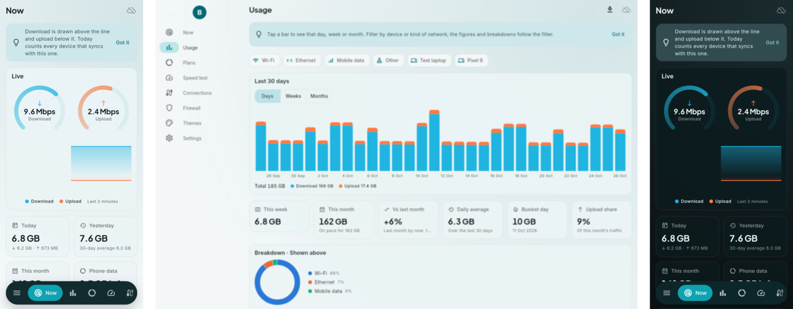
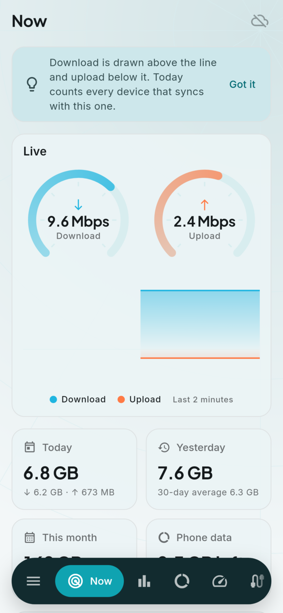
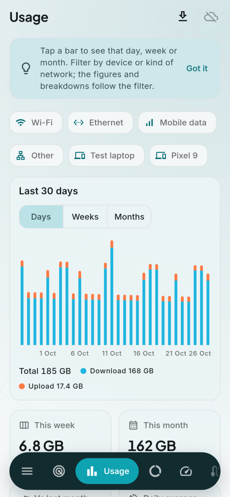
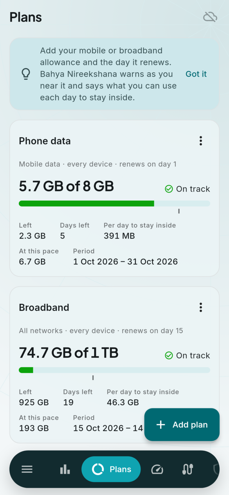
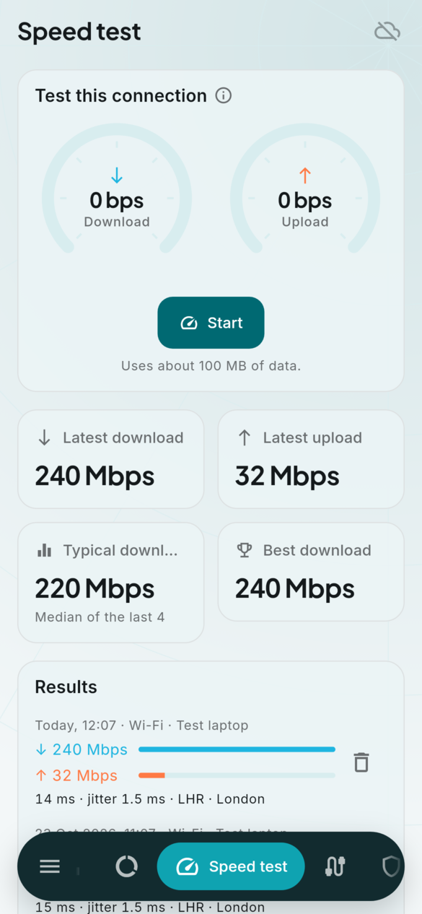
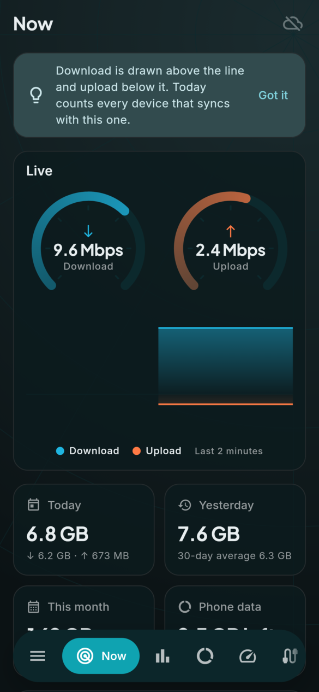
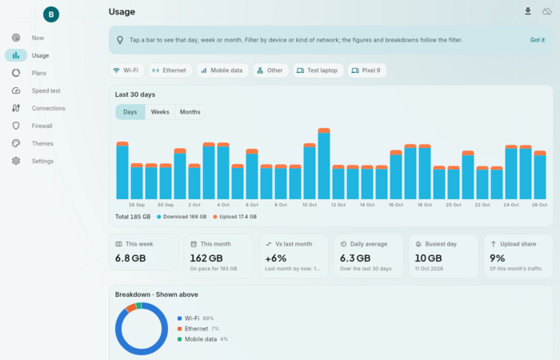
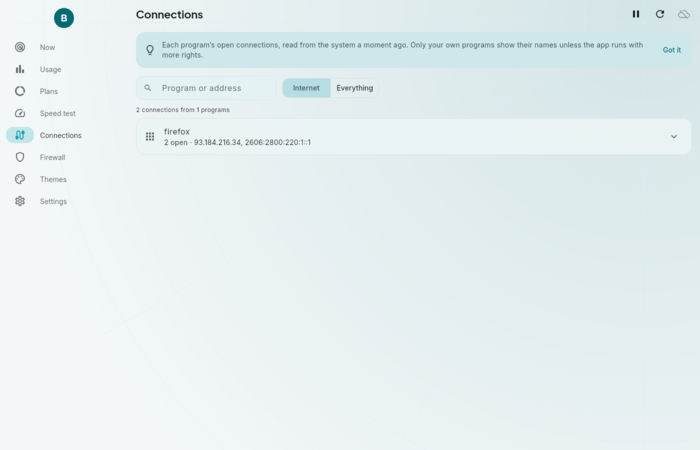
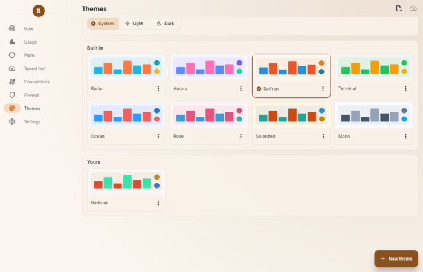

<h1 align="center">
  <br>
  <a href="https://github.com/sudharamachandranrajeev/bahya-nireekshana"></a>
  <br>
  Bahya Nireekshana
  <br>
</h1>

<h4 align="center">A network monitor for Linux, Windows, Android and the browser: live speed, usage history, data plans, connections and a firewall.</h4>

<p align="center">
  <a href="https://github.com/sudharamachandranrajeev/bahya-nireekshana/releases"></a>
  
  
  
</p>

<p align="center">
  <a href="#key-features">Key Features</a> •
  <a href="#how-to-use">How To Use</a> •
  <a href="#download">Download</a> •
  <a href="#credits">Credits</a> •
  <a href="#related">Related</a> •
  <a href="#license">License</a>
</p>

<p align="center">
  
</p>

## Key Features

*Bāhya nirīkṣaṇa* is Sanskrit for "watching what goes out". The app shows what your devices send and
receive, keeps the history, and warns you before a data plan runs out.

* **Now** – live download and upload speed on two gauges and a two-minute chart, today and yesterday,
  this month, the nearest data plan and every network interface. Notes when today runs well above your
  usual day.
* **Usage** – days, weeks or months as a stacked chart. Tap a bar to see that period. Filter by kind of
  network (Wi-Fi, Ethernet, mobile data) or by device. Figures for this week and month, the month's
  projected total, the change against last month, the daily average, the busiest day and the upload
  share. Breakdowns by network and by device. Export to CSV.
* **History from the system** – on Linux the app reads vnstat when it is installed, and on Android it
  reads the system's network statistics (after you allow usage access), so the history goes back
  further than the app's own install. Elsewhere, and as a fallback, the app records its own counters
  once a minute while it runs.
* **Data plans** – a mobile or broadband allowance with the day it renews. Shows what is used and left,
  where the period is, the total at the current pace, and how much you can use each day to stay inside.
  Warns when you pass the level you choose.
* **Speed test** – download and upload speed, latency and jitter against Cloudflare's speed test, with
  the history of results by network and device.
* **Connections** (Linux, Windows) – every open socket grouped by program, with the remote address and
  state. Internet-only or everything, searchable, refreshed every 5 seconds.
* **Firewall** (Linux) – block or allow domains and address ranges, and review the rules OpenSnitch
  holds, through the helper the Omarchy setup installs.
* **Themes and theme manager** – eight built-in themes (Radar, Aurora, Saffron, Terminal, Ocean, Rose,
  Solarized, Mono), light, dark or system. Make your own with an editor that has a live preview and
  contrast warnings, or import, copy and export themes as JSON. The browser extension reads the same
  theme files.
* **In-app updater** – on Linux, Windows and Android the app checks GitHub releases, downloads the
  build for your platform, checks it against the release's `SHA256SUMS.txt` and installs it.
* **Browser extension** – data used by each website in Chrome, Edge and Firefox, with a popup, a
  dashboard, a blocklist, daily budgets and the app's themes. See [extension/](extension/README.md).
* **Omarchy bar widget** – live speed in the Omarchy bar with a panel of usage, connections and
  firewall rules. See [omarchy/](omarchy/README.md).
* **Private by design** – encrypted local database (SQLite3MultipleCiphers) and optional end-to-end
  encrypted sync with your other devices through your own server, one account across every
  Brahma app. Each device writes only its own usage, so sync never mixes two devices' numbers. The
  only requests the app makes itself are the speed test you start and the update check.

## Screenshots

<table>
  <tr>
    <td align="center"><br><sub>Now</sub></td>
    <td align="center"><br><sub>Usage</sub></td>
    <td align="center"><br><sub>Plans</sub></td>
    <td align="center"><br><sub>Speed test</sub></td>
    <td align="center"><br><sub>Now (dark)</sub></td>
  </tr>
</table>

<p align="center">
  <br>
  <sub>Usage on desktop</sub>
</p>

<table>
  <tr>
    <td align="center"><br><sub>Connections</sub></td>
    <td align="center"><br><sub>Themes (Saffron)</sub></td>
  </tr>
</table>

## How To Use

To clone and run this application, you'll need [Git](https://git-scm.com) and
[Flutter](https://flutter.dev) 3.47 installed:

```bash
# Clone this repository
$ git clone https://github.com/sudharamachandranrajeev/bahya-nireekshana

# Go into the repository
$ cd bahya-nireekshana

# Install dependencies and generate the database code
$ flutter pub get
$ dart run build_runner build -d

# Run the app
$ flutter run -d linux

# Test and format
$ flutter test
$ dart format -l 110 lib test

# Render the pages to PNG with the real fonts
$ NIREEKSHANA_SHOTS=/tmp/shots flutter test test/screenshots_test.dart

# The browser extension: test, then build the Chrome and Firefox packages
$ node --test 'extension/tests/*.test.mjs'
$ extension/build.sh
```

`brahma_core` comes from the [brahma](https://github.com/sudharamachandranrajeev/brahma) repository.
To work on it locally, add a gitignored `pubspec_overrides.yaml` pointing at `../brahma/core`.
`scripts/install-linux.sh` installs a build from a checkout into your app menu.

On Linux, install `vnstat` for history from before the app started. The Connections and Firewall pages
use the setup in [omarchy/](omarchy/README.md) (`sudo omarchy/install.sh`), written for Omarchy and other
Arch-based systems.

## Download

Builds are on the [releases page](https://github.com/sudharamachandranrajeev/bahya-nireekshana/releases),
each with `SHA256SUMS.txt`. See the [changelog](CHANGELOG.md) for what is new.

* **Linux (x86-64)** – unpack `Nireekshana-<version>-linux-x64.tar.gz` and run `./install.sh` to add it
  to your app menu (no root needed; `./install.sh --uninstall` removes it, your data stays). Needs GTK 3,
  libsecret and a running keyring.
* **Windows 10/11** – run `Nireekshana-<version>-windows-x64-setup.exe`, or unzip the portable build.
* **Android 7+** – install `Nireekshana-<version>-android.apk`. Allow usage access when the app asks, for
  history and mobile data counts.
* **Chrome and Edge** – unzip `Nireekshana-<version>-chrome.zip`, open `chrome://extensions`, turn on
  developer mode and choose *Load unpacked*.
* **Firefox** – open `about:debugging`, *This Firefox*, *Load Temporary Add-on* and pick
  `Nireekshana-<version>-firefox.zip`.

## Credits

This software uses the following open source packages and services:

- [Flutter](https://flutter.dev) and [Riverpod](https://riverpod.dev)
- [drift](https://drift.simonbinder.eu) over [SQLite3MultipleCiphers](https://utelle.github.io/SQLite3MultipleCiphers/) for the encrypted database
- [vnstat](https://humdi.net/vnstat/), [nethogs](https://github.com/raboof/nethogs) and [OpenSnitch](https://github.com/evilsocket/opensnitch) on Linux
- [Cloudflare's speed test](https://speed.cloudflare.com) endpoints
- [file_picker](https://pub.dev/packages/file_picker), [url_launcher](https://pub.dev/packages/url_launcher), [package_info_plus](https://pub.dev/packages/package_info_plus) and [intl](https://pub.dev/packages/intl)
- Fonts [Inter](https://rsms.me/inter/) and [Plus Jakarta Sans](https://github.com/tokotype/PlusJakartaSans), bundled under the SIL Open Font License

## Related

Bahya Nireekshana is part of **Brahma**, a suite of life-management apps that share one encrypted account:

* [brahma](https://github.com/sudharamachandranrajeev/brahma) – the shared core and the all-in-one Brahma app
* [Artha](https://github.com/sudharamachandranrajeev/artha) – personal finance
* [Vidya](https://github.com/sudharamachandranrajeev/vidya) – learning and career training
* [Udyoga](https://github.com/sudharamachandranrajeev/udyoga) – career and job search
* [Graha Anveshana](https://github.com/sudharamachandranrajeev/graha-anveshana) – property search
* [Vahana Anveshana](https://github.com/sudharamachandranrajeev/vahana-anveshana) – car search

## License

No licence has been chosen yet; all rights reserved.

---

> GitHub [@sudharamachandranrajeev](https://github.com/sudharamachandranrajeev)
